# Visa Automatic database schema architecture audit

Date: 2026-10-13
Starting commit: `74b3cbf4f367a148872cf74191b111f8e69ff394`
Protected Phase-C/D checkpoint: `cd2093e`
Audited ORM inventory: 57 application tables

Machine-readable companion: [`schema-architecture.json`](schema-architecture.json).
It is generated from the same loaded ORM metadata by
`tools/export_database_architecture.py` and records every column, PostgreSQL
type, constraint, index, foreign-key edge, domain, and data-authority category.

## Decision

The existing `cases`, typed Canada aggregate, confirmed fact decisions, and
historical evidence tables remain the architecture. No parallel review
application and no JSON-only application store is introduced.

The previous migration chain was not a stable installation artifact. Revisions
`0007`, `0008`, `0009`, `0010`, `0011`, and `0013` created historical tables
from the current ORM metadata. Their behavior therefore changed when later
columns and constraints were added. The active chain has been replaced with
the explicit, immutable `0001_consolidated_schema` baseline. The old files are
archived outside Alembic's active `versions` directory.

## Entity relationship overview

```mermaid
erDiagram
    CASES ||--o{ PERSONS : contains
    CASES ||--o| CANADA_APPLICATIONS : owns
    CASES ||--o{ FACTS : confirms
    CASES ||--o{ CANONICAL_VALUE_REVISIONS : records
    CASES ||--o{ REQUIREMENTS : derives
    CASES ||--o{ DOCUMENTS : receives
    CASES ||--o{ TASKS : schedules
    CASES ||--o{ WORKFLOW_TRANSITIONS : histories
    CASES ||--o{ CANADA_LEGACY_IMPORT_RUNS : imports
    CASES ||--o{ CONVERSATION_IMPORTS : receives
    CASES ||--o{ PREPARATION_RUNS : generates
    CASES ||--o{ PREPARATION_APPROVALS : approves

    PERSONS ||--o{ CASE_PERSON_ROLES : has
    PERSONS ||--o| PERSON_BIOGRAPHIES : describes
    PERSONS ||--o{ PERSON_CITIZENSHIPS : has
    PERSONS ||--o{ PERSON_IDENTIFIERS : has
    PERSONS ||--o{ CONTACT_POINTS : has

    CANADA_APPLICATIONS ||--o{ CANADA_ADDRESSES : contains
    CANADA_APPLICATIONS ||--o{ TRAVEL_DOCUMENTS : contains
    CANADA_APPLICATIONS ||--o| TRIP_PLANS : contains
    CANADA_APPLICATIONS ||--o{ FAMILY_RELATIONSHIPS : contains
    CANADA_APPLICATIONS ||--o{ EDUCATION_RECORDS : contains
    CANADA_APPLICATIONS ||--o{ ACTIVITY_RECORDS : contains
    CANADA_APPLICATIONS ||--o{ RESIDENCE_HISTORY_RECORDS : contains
    CANADA_APPLICATIONS ||--o{ TRAVEL_HISTORY_RECORDS : contains
    CANADA_APPLICATIONS ||--o{ OFFICIAL_APPLICATION_ANSWERS : contains

    DOCUMENTS ||--o{ DOCUMENT_PROCESSING_ATTEMPTS : processes
    DOCUMENTS ||--o{ DOCUMENT_CLASSIFICATIONS : classifies
    DOCUMENTS ||--o{ DOCUMENT_QUALITY_CHECKS : evaluates
    DOCUMENTS ||--o{ DOCUMENT_REMEDIATION_ISSUES : remediates
    DOCUMENTS ||--o{ REQUIREMENT_DOCUMENT_MATCHES : matches
    REQUIREMENTS ||--o{ REQUIREMENT_DOCUMENT_MATCHES : accepts
    REQUIREMENTS ||--o{ REQUIREMENT_COMPLETENESS_EVALUATIONS : evaluates
    REQUIREMENTS ||--o{ REQUIREMENT_FULFILLMENT_EVENTS : histories

    PREPARATION_RUNS ||--o{ PREPARATION_ARTIFACTS : emits
    PREPARATION_RUNS ||--o{ PREPARATION_APPROVALS : reviews
    AUTH_USERS ||--o{ AUTH_SESSIONS : authenticates
    AUTH_USERS ||--o{ APPLICATION_AUDIT_EVENTS : acts
```

## Complete schema inventory

### Core Case and audit

| Table | Responsibility | Lifecycle |
| --- | --- | --- |
| `cases` | Case identity and persisted compatibility workflow state | Mutable root |
| `persons` | Case-scoped people; `roles` is a compatibility projection | Mutable |
| `case_person_roles` | Authoritative operational roles | Mutable assignment history is audited by services |
| `facts` | Confirmed/proposed/conflicting generic fact decisions | Mutable current facts |
| `canonical_value_revisions` | Field-level canonical value ledger | Append-only by contract |
| `tasks` | Operational work | Mutable |
| `workflow_transitions` | State transition history | Historical |
| `application_audit_events` | Security/business audit events | Append-only ORM protection |

### Authentication

`auth_users`, `auth_sessions`, `auth_mfa_challenges`,
`auth_login_throttles`, and `auth_security_events` implement Argon2id/TOTP
authentication, revocable server sessions, throttling, and security history.
Session and challenge tokens are stored only as hashes; the MFA secret is
encrypted by application code.

### Intake and evidence

`intake_submissions`, `intake_processing_attempts`,
`canada_legacy_import_runs`, `canada_import_candidates`,
`legacy_import_entity_links`, `field_provenance_reviews`,
`conversation_imports`, `conversation_messages`, `fact_extraction_runs`, and
`fact_extraction_candidates` retain source receipt, attempts, candidates,
evidence, provenance, and employee decisions. Candidate rows do not become
canonical merely because they exist or an extraction completed.

### Typed Canada aggregate

The aggregate consists of `canada_applications`, `person_biographies`,
`person_citizenships`, `person_identifiers`, `contact_points`,
`canada_addresses`, `applicant_residences`, `travel_documents`, `trip_plans`,
`canada_organizations`, `funding_sources`, `host_records`,
`family_relationships`, `education_records`, `activity_records`,
`residence_history_records`, `travel_history_records`,
`official_application_answers`, `official_explanations`,
`representative_profiles`, `representative_profile_revisions`, and
`representative_authorizations`.

This typed structure remains authoritative. The root `canada.CanadaCase`
object is an import/generator adapter representation only.

### Documents and requirements

`documents`, `document_processing_attempts`, `document_remediation_issues`,
`document_classifications`, `document_quality_checks`, `requirements`,
`requirement_document_matches`, `requirement_completeness_evaluations`, and
`requirement_fulfillment_events` implement evidence storage metadata,
idempotent processing, explicit review, matching, and auditable completeness.

### Preparation and approval

`preparation_runs`, `preparation_artifacts`, and `preparation_approvals` bind a
generated package and its two approval stages to a Case and canonical payload
hash. Superseded runs and artifacts remain historical.

## Data authority

| Concern | Authority | Non-authoritative evidence/projection |
| --- | --- | --- |
| Case identity | `cases` | Intake source names and import IDs |
| Operational person role | `case_person_roles` | `persons.roles` compatibility JSON |
| Canada application values | Typed Canada tables | Import/message candidates, generator object |
| Sponsor/host/payer decisions | Confirmed defined `facts` plus typed selected party records | Candidate suggestions |
| Current document metadata | `documents` after explicit employee confirmation | Classification results |
| Requirement state | `requirements` plus fulfillment events | Readiness and issue projections |
| Generated package | Matching `preparation_runs` and `preparation_artifacts` | Temporary generator output |
| Approval state | Latest applicable `preparation_approvals` for exact payload/run | UI state |

## Database-enforced invariants

- UUID primary keys and foreign keys with explicit `CASCADE`, `SET NULL`, or
  `RESTRICT` behavior.
- Unique Case number and at most one Canada application per Case.
- Partial unique selected applicant and representative roles per Case.
- Unique canonical revision number per `(case_id, field_path)`.
- Source-hash/external-ID intake deduplication and immutable attempt numbering.
- One primary citizenship/passport/current residence where the model requires
  explicit selection.
- Unique Requirement/Document match.
- Check constraints for workflow, review, classification, quality, intake,
  pipeline, remediation, fulfillment, run, artifact, and approval states.
- One pipeline attempt per `(document_id, idempotency_key)`.
- Retry and remediation attempt links must identify an attempt belonging to
  the same Document.
- At most one `running` preparation run per Case through a PostgreSQL partial
  unique index.
- One artifact type per preparation run.
- Artifact `case_id` must match its preparation run.
- Package-review approval must reference a preparation run; generation
  approval must not reference a run.
- Package-review Case and payload hash must match the referenced run.

## Application-enforced invariants

The following cannot be represented cleanly by ordinary portable relational
constraints without adding duplicated ownership columns or database triggers:

- Monotonic revision allocation under the canonical decision transaction.
- Polymorphic `entity_type`/`entity_id` and address-owner references.
- All typed Person references belonging to the same Case/application.
- Requirement and Document in a match belonging to the same Case.
- Historical rows being append-only for database roles with unrestricted SQL.
- A generated package being current relative to a newly computed canonical
  payload hash.
- READY requiring both current artifact integrity and the latest applicable
  approval.

The services validate these rules. PostgreSQL roles used by the application
must not be treated as an administrative bypass boundary.

## Defects found and corrections

### Corrected

1. Historical migrations dynamically imported current ORM metadata. They were
   removed from the active chain and archived.
2. `0008` could create `raw_value_json` before `0012` attempted to add it. The
   single baseline creates the final column once.
3. Phase-C retry and remediation foreign keys previously allowed references to
   attempts belonging to another Document. Composite foreign keys now enforce
   same-Document ownership.
4. Pipeline stages and remediation resolution state lacked complete database
   checks. Explicit constraints now validate them.
5. Preparation artifacts could name a Case different from their run. A
   composite foreign key now prevents it.
6. Package review approvals could reference a run from another Case or use a
   different payload hash. Composite identity constraints now prevent it.
7. Deployment scripts and health checks used the former migration head. The
   authoritative head is now `0001_consolidated_schema`.

### Recorded technical debt; no schema expansion in this task

- Legacy typed Canada CRUD routes can bypass `CanonicalDecisionService`.
- Preparation status reads can regress a stale READY workflow state.
- CSV and message candidates remain source-specific persistence models.
- Business lifecycle stages remain a projection over legacy workflow states.
- Document processing remains synchronous.

These are service/lifecycle concerns. None requires a competing aggregate or a
new table to make fresh schema initialization correct.

## Migration compatibility impact

The new baseline supports fresh database initialization only. An existing
database on `0001_core_data_model` through `0018_doc_pipeline_final_review`
must not be stamped into the new history. For the synthetic Raspberry staging
database, use the guarded rebuild procedure after explicit approval. A database
containing retained business data would require a separately designed export,
rebuild, and validated import migration.
